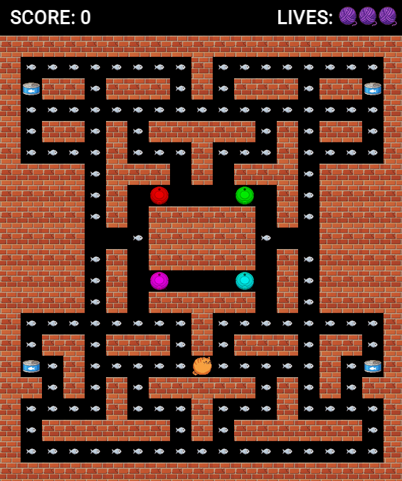

# pf-pacman

A Pac-Man style game written in C++ with SFML. You play as Bob, a cat who eats fish and tuna while avoiding four vacuum cleaners.

## Team Members

| Roll Number | Name |
|-------------|------|
| 0507 | Muhammad Ibrahim |
| 0513 | Muzamil Tanveer |
| 0534 | Arhum Sumbal |

Course: CS1002 Programming Fundamentals, FAST NUCES

## Screenshot

## Controls

**Menu**

| Key | Action |
|-----|--------|
| Up / W | Move selection up |
| Down / S | Move selection down |
| Enter | Select the highlighted option |

Menu options: **New Game**, **Continue** (loads the last saved game), **Exit**.

**In game**

| Key | Action |
|-----|--------|
| Arrow keys or W A S D | Move Bob |
| Esc | Save the game and return to the menu |

**Win / Game Over screen**

| Key | Action |
|-----|--------|
| Enter | Return to the menu |

## How to Play

- Eat every fish and tuna on the map to win.
- Bob starts with 3 lives, shown as yarn balls in the top right. Touching a vacuum costs one life.
- Fish are worth 10 points.
- Tuna is worth 50 points and scares the vacuums for 5 seconds. 
- A scared vacuum is slower and can be eaten for 200 points, after which it respawns at its start position.
- The vacuums wait until Bob makes his first move. The red and magenta vacuums chase Bob, and the green and cyan vacuums wander randomly.
- The game ends when all lives are lost.

## How to Run

### Requirements

- A C++ compiler with C++17 support
- [SFML 3.1.0](https://www.sfml-dev.org/download.php) (the code uses the SFML 3 API)

### Steps

1. Clone this repository.
2. Open the project in your IDE and link SFML (Graphics, Window, System and Audio).
3. Build the project.
4. Run the game from the folder that contains 'maze.txt'